<div align="center">

  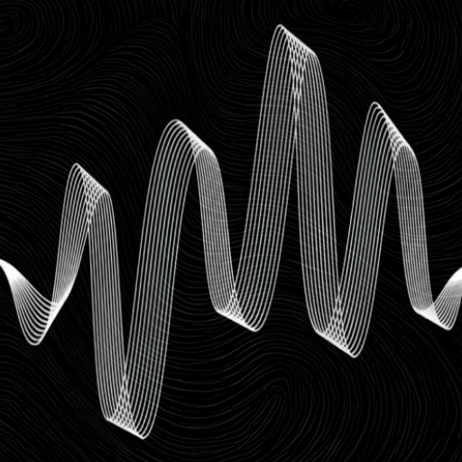

  # E C H O
  
  **A fleeting space for the things we carry.**  
  *No accounts. No history. No judgment. Every thought fades after 48 hours.*
  **Playstore Link: https://play.google.com/store/apps/details?id=com.j3labs.echo** 

  <br/>

  [-3DDC84?style=for-the-badge&logo=android&logoColor=white)](https://developer.android.com)
  [](https://kotlinlang.org)
  [](https://developer.android.com/jetpack/compose)
  [](https://supabase.com)
  [](https://firebase.google.com)
  [](#)
  [](LICENSE)

  <br/><br/>

  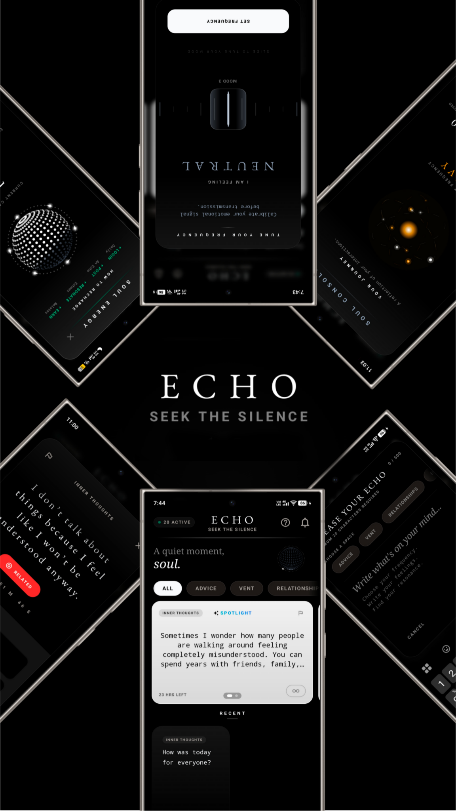

</div>

---

## 📖 Table of Contents

- [Vision & Philosophy](#-vision--philosophy)
- [Visual Showcase](#-visual-showcase)
- [Core Features](#-core-features)
- [Architecture & Tech Stack](#-architecture--tech-stack)
- [Project Structure](#-project-structure)
- [Getting Started & Local Setup](#-getting-started--local-setup)
- [Supabase Backend Architecture](#-supabase-backend-architecture)
- [Privacy & Security by Design](#-privacy--security-by-design)
- [Contributing](#-contributing)
- [Creator & Contact](#-creator--contact)

---

## 🌌 Vision & Philosophy

Modern social platforms are engineered for permanence, surveillance, and performance anxiety. Every opinion is archived indefinitely, tied to a permanent identity, and quantified through algorithmic vanity loops.

**ECHO** is built as an antidote to modern digital noise:

- **Ephemeral Life Cycle (48 Hours):** Nothing in the Void lasts forever. Every whisper, confession, and reply automatically dissolves into silence after 48 hours.
- **Absolute Anonymity (Zero Account Lock-in):** No email sign-ups, no passwords, no phone number verifications, and no user profiles. Your presence is backed by an ephemeral device-bound cryptographic **Soul Signature**.
- **Tactile Emotional Tuning:** Instead of an engagement-driven algorithmic feed, users manually tune their internal frequency to match their current emotional state.
- **Pure Resonance:** There are no follower counts or public social graphs. You resonate with thoughts, exchange anonymous replies, and let go.

---

## 📸 Visual Showcase

### Mobile Experience & Highlights

| **Anti-Social Manifesto** | **Frequency Dial** | **Themed Spaces** | **Live Feed & Broadcasts** |
| :---: | :---: | :---: | :---: |
| 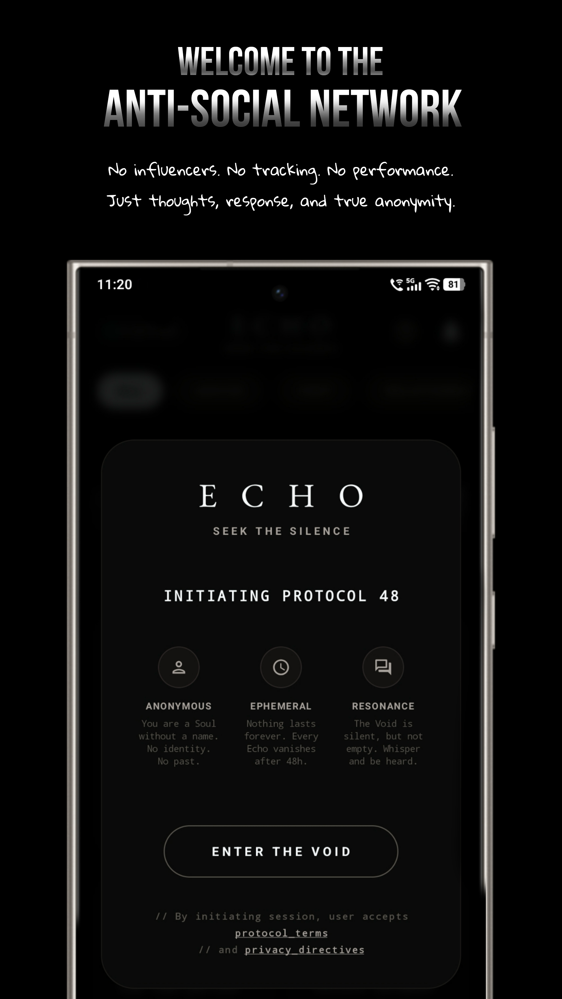 | 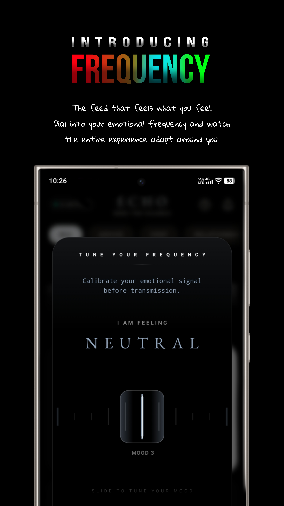 | 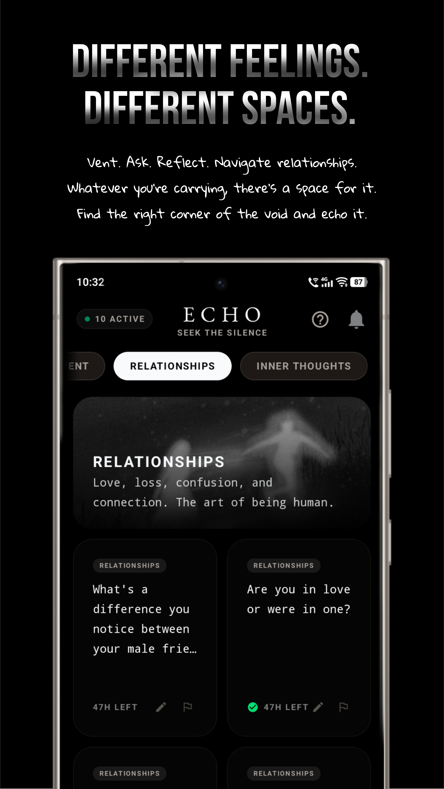 | 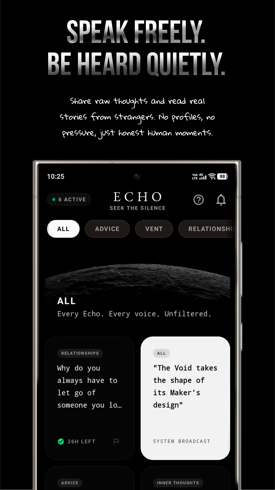 |
| *Protocol 48 Introduction* | *Tactile Mood Calibration* | *Curated Emotional Corners* | *48H Ephemeral Stream* |

<br/>

### Interface & Experience Walkthrough

<div align="center">

| Feature | Preview |
|---|---|
| **Protocol 48 Onboarding**<br/>*True anonymity. No tracking. Pure thoughts.* | 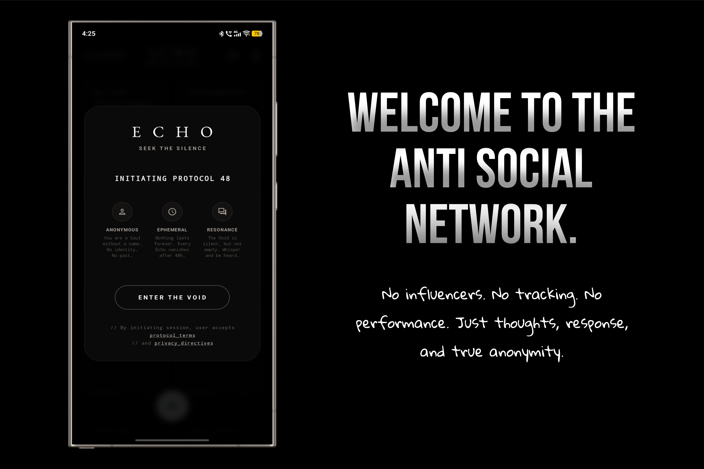 |
| **Speak. Be Heard. Disappear.**<br/>*48-hour auto-decay countdown timers.* | 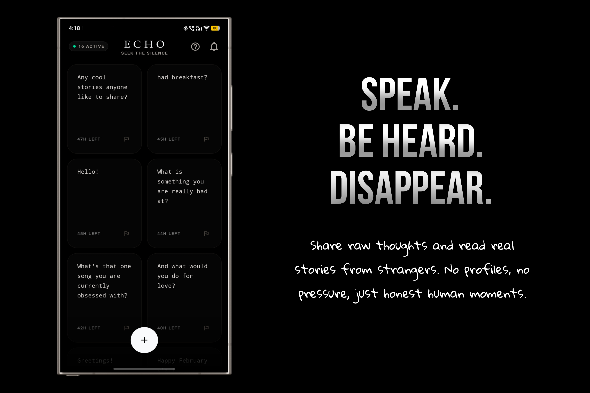 |
| **Whisper Composer**<br/>*Say anything. Leave behind nothing.* | 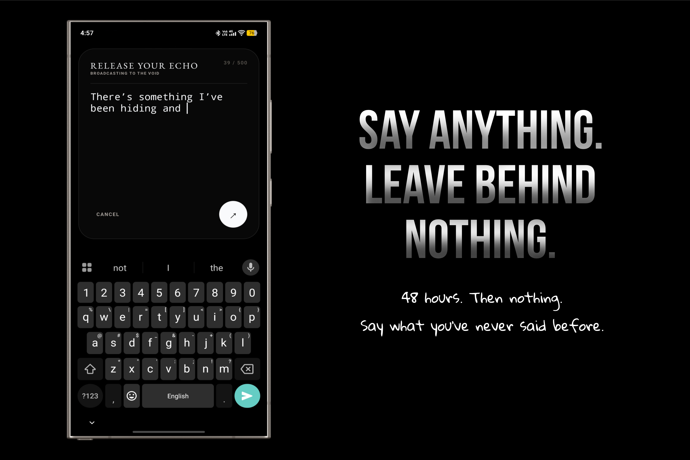 |
| **Anonymous Resonances**<br/>*Connect thoughts, not faces.* | 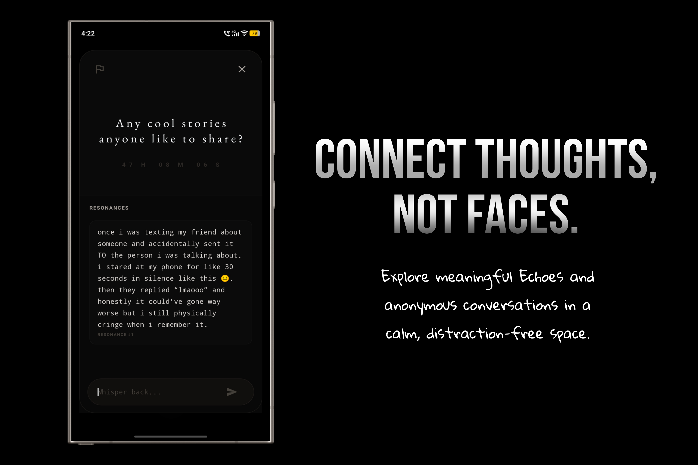 |
| **The Void Everywhere**<br/>*Seamless across mobile and web.* | 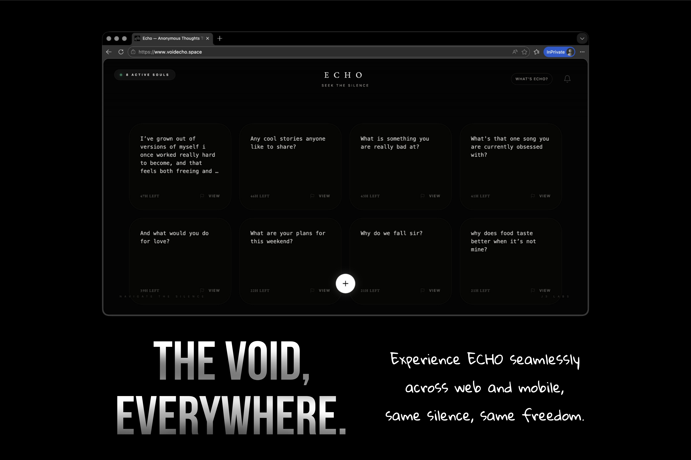 |

</div>

---

## ✨ Core Features

### 1. 🎛️ Tactile Frequency Tuner
- A custom hardware-feel rotary dial rendered directly in Compose Canvas.
- Offers calibrated haptic ticks on every graduation.
- Filters the Void into five emotional wavelengths:
  - 🔴 **DISTURBED** (`#FFFF453A`)
  - 🟠 **HEAVY** (`#FFFF9F0A`)
  - ⚪ **NEUTRAL** (`#94A3B8`)
  - 🔵 **CALM** (`#64D2FF`)
  - 🟢 **RADIANT** (`#34C759`)

### 2. 🌀 3D Gravity Gyroscope & Soul Energy
- Integrated with Android `SensorManager` and `Sensor.TYPE_ACCELEROMETER`.
- Renders an interactive 3D particle sphere using real-time trigonometric math and gravity vector physics.
- Tilting your physical device shifts the liquid surface and orbital particle halos in real-time.
- Energy is charged through daily check-ins and meaningful resonances.

### 3. 💡 The Spotlight System
- When your **Soul Energy** reaches 100%, you can activate **Spotlight Mode** on your next Echo.
- Spotlight converts the post into an inverted, luminous card featuring a dynamic chromatic aurora border, guaranteeing visibility in the dark feed.

### 4. 🔑 Cryptographic Soul Signatures & Device Portability
- Users don't register accounts; an anonymous, deterministic UUID signature is generated on first launch.
- Users can export their **Soul Key** to transfer their karma, energy level, and journey stats to a new device or browser without revealing their personal identity.

### 5. 🪐 Themed Spaces
- Categorize whispers into distinct mental spaces:
  - `Inner Thoughts`
  - `Vent`
  - `Advice`
  - `Relationships`
  - `All (Collective Consciousness)`

### 6. 📊 Emotional Journey & Telemetry
- A privacy-preserving personal telemetry dashboard.
- Displays monthly mood calendars, dominant mood calculations, activity streaks, and lifetime resonance statistics.

### 7. 📡 Offline-First Architecture & WorkManager
- Fully resilient against intermittent network connections.
- Whispers and resonances created offline are queued in local cache and seamlessly synced when connectivity is restored via AndroidX `WorkManager` (`EchoWorker`).
- Optimistic UI updates ensure instantaneous UI response for relates and un-relates.

### 8. 🔔 The Secret Log & Deep Linking
- Real-time notifications powered by Firebase Cloud Messaging (FCM) synced to Supabase installation records.
- Tapping on a resonance notification directly deep-links the user into the relevant Echo thread with a fluid entry transition.

### 9. ⚡ Hardware Display Optimization (120Hz)
- Explicit display mode negotiation via `Window.attributes.preferredDisplayModeId` unlocks native 90Hz / 120Hz panels for maximum fluid motion.

---

## 🛠️ Architecture & Tech Stack

ECHO is engineered according to **Clean Architecture** and **Modern Android Development (MAD)** standards:

```
┌────────────────────────────────────────────────────────┐
│               PRESENTATION LAYER (UI)                  │
│   Jetpack Compose • Material 3 • Navigation Compose    │
│   Custom Canvas Graphics • Sensors • ExoPlayer         │
└───────────────────────────▲────────────────────────────┘
                            │ (StateFlow / UI Events)
┌───────────────────────────┴────────────────────────────┐
│                    DOMAIN LAYER                        │
│   Use Cases • Repository Interfaces • Domain Models    │
└───────────────────────────▲────────────────────────────┘
                            │
┌───────────────────────────┴────────────────────────────┐
│                     DATA LAYER                         │
│   Supabase PostgREST & Realtime • Firebase Messaging   │
│   AndroidX WorkManager • DataStore & SharedPreferences │
└────────────────────────────────────────────────────────┘
```

| Component | Technology | Description |
|---|---|---|
| **Language** | Kotlin 2.0+ | Coroutines, Flow, StateFlow, Serialization |
| **UI Framework** | Jetpack Compose (BOM 2024+) | Declarative UI, Animations, Edge-to-Edge |
| **Design System** | Material 3 + Custom Void Theme | Pure OLED black palette, custom Serif typography |
| **Dependency Injection** | Dagger Hilt 2.51+ | Singleton & ViewModel injection, Hilt WorkerFactory |
| **Backend & Database** | Supabase (Kotlin SDK) | PostgREST, Realtime listeners, custom Postgres RPCs |
| **Push Notifications** | Firebase Cloud Messaging (FCM) | Background and foreground alert delivery |
| **Background Sync** | AndroidX WorkManager | Periodic 15-minute background synchronization |
| **Media & Audio** | AndroidX Media3 ExoPlayer | High-performance looping video onboarding |
| **Sensors** | Android Sensor Framework | Accelerometer-based physics simulation |
| **Local Storage** | SharedPreferences & DataStore | Offline queues, installation tokens, cached preferences |
| **Google Play APIs** | Play In-App Review & App Update | Seamless in-app feedback and flexible updates |

---

## 🛡️ Privacy & Security by Design

- **Zero Advertising Trackers:** The Google Advertising ID permission is explicitly removed:
  ```xml
  <uses-permission android:name="com.google.android.gms.permission.AD_ID" tools:node="remove"/>
  ```
- **Zero Third-Party Ad Networks:** No AdMob, Meta Audience Network, or data broker SDKs.
- **No PII Stored:** No phone numbers, real names, GPS locations, or contacts are accessed or saved.
- **Hardware-Only Identity:** Your cryptographic Soul Signature remains local to your device unless explicitly exported by you.

---

## 🏢 Creator & Contact

Designed and engineered with care by **J3 Labs**.

- **Website:** [thej3labs.com](https://www.thej3labs.com)
- **Web App:** [voidecho.space](https://www.voidecho.space)
- **Support & Inquiries:** `thej3labs@gmail.com`
- **Privacy Policy:** [voidecho.space/privacy](https://www.voidecho.space/privacy)
- **Terms of Service:** [voidecho.space/terms](https://www.voidecho.space/terms)

<br/>

<div align="center">
  <sub>Everything you leave behind belongs to the Void.</sub>
</div>

